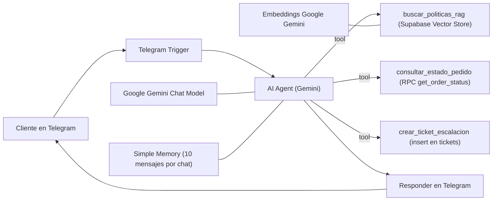
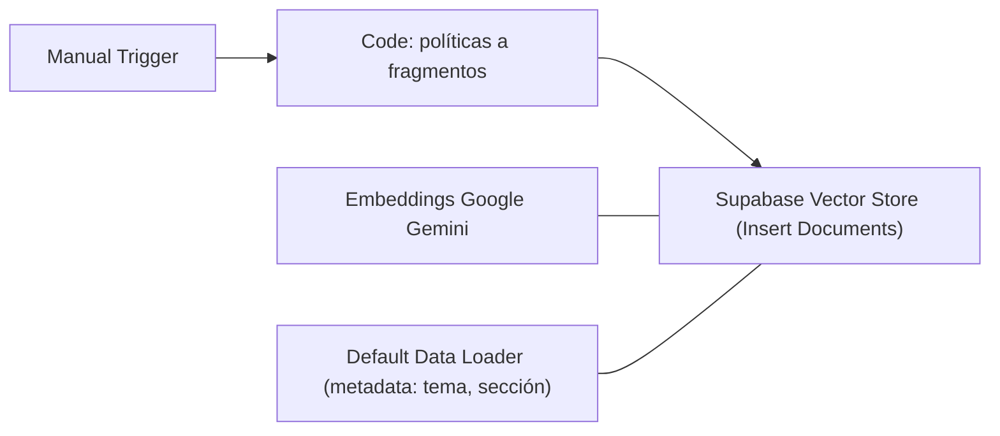
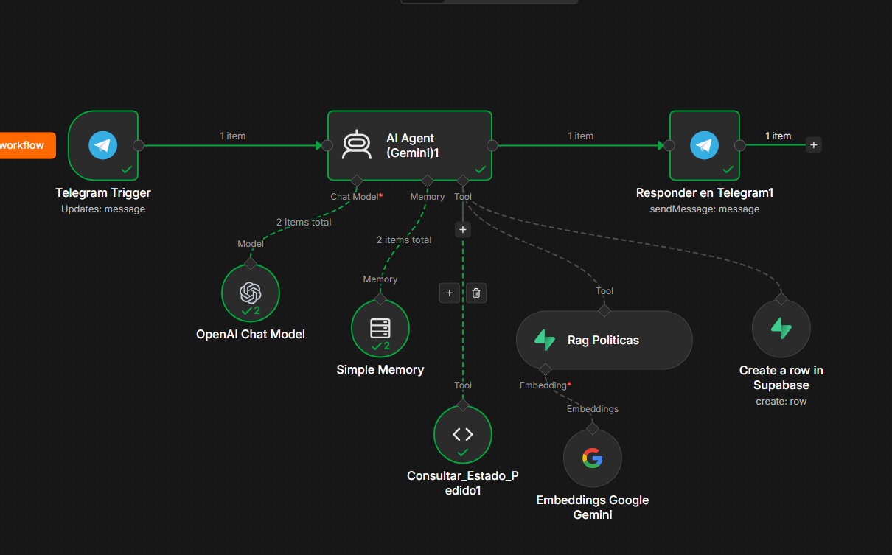

# CalzaIsoft: agente de soporte para una zapatería en línea

Proyecto B (Soporte de una tienda en línea). Agente de IA en Telegram construido con **n8n + Gemini + Supabase**.


---

## 1. Integrantes

| Nombre completo | Matrícula | Rol |
|---|---|---|
| Jorge Silvano Salazar Vega | 24040040 | Workflow de ingesta, tool de RAG_Politicas, configuracion de memoria |
| Abisaid Guadalupe Angulo Munguia | 24040115 | Configuracion de AiAgent, tool consultar_Estado, Pruebas |
| Edgar Gael Reyez Quevedo | 24040158 | Configuracion de BD en supabase, tool ticket_Escalado, pruebas |


---

## 2. Escenario y problema que resuelve

CalzaIsoft es una zapatería ficticia que vende tenis, botas, sandalias, zapatos de vestir y calzado escolar por internet. Sus clientes hacen siempre las mismas preguntas: cuánto tarda y cuesta el envío, cómo cambiar una talla, si un producto tiene garantía, dónde está su pedido y qué hacer si llegó dañado. El agente atiende estas dudas por Telegram a cualquier hora: responde con las políticas reales de la tienda (RAG sobre Supabase), consulta el estado de un pedido y, cuando el caso necesita a una persona, crea un ticket con el contexto de la conversación para que un asesor lo tome. El reto central es **escalar a humano en el momento justo**: ni antes (resolver lo que una política ya responde) ni después (insistir cuando el cliente pide una persona o el caso requiere una decisión humana).

---

## 3. Diagrama del workflow

### Workflow del agente (`workflows/Agente01.json`)



### Workflow de carga de políticas (`workflows/ingesta.json`)

Se ejecuta a mano una vez, y cada vez que cambia una política.



### Captura




---

## 4. Tools del agente

| Tool | Qué hace | Cuándo debería usarla el agente | Lee / Escribe |
|---|---|---|---|
| `buscar_politicas_rag` (nodo *Rag Politicas*) | Busca por similitud en `policy_documents` (pgvector en Supabase) los fragmentos de política más cercanos a la pregunta y se los devuelve al agente. | Dudas sobre envíos, devoluciones y cambios de talla, garantía, guía de tallas, horarios y contacto. Siempre antes de responder una duda de política. | Lee |
| `consultar_estado_pedido` | Llama a la función SQL `get_order_status` de Supabase y devuelve estado, paquetería, guía, fecha estimada y productos del pedido. Exige número de pedido **y** correo del cliente, para no exponer pedidos ajenos. | Cuando el cliente pregunta dónde está su pedido o qué contiene. | Lee |
| `crear_ticket_escalacion` (nodo *Create a row in Supabase*) | Inserta una fila en `tickets` con asunto, descripción, categoría, motivo de escalación, prioridad, correo, pedido y resumen de la conversación. | Cuando el cliente pide hablar con una persona, reporta un producto roto, dañado o incompleto, el caso requiere una decisión humana, o las otras tools no resuelven la duda. | Escribe |

**Criterios de escalamiento** (el reto del proyecto):

- Escala de inmediato si el cliente pide hablar con una persona.
- Escala si reporta un producto dañado o incorrecto (antes pide número de pedido y qué ocurrió).
- Escala si necesita una decisión humana: excepción a una política, compensación o reembolso fuera de plazo.
- Escala si ya intentó resolver y el cliente sigue sin solución o insiste con molestia.
- No escala si una política o el estado del pedido ya responde la duda.

---

## 5. Stack por capa

| Capa | Elección | Por qué |
|---|---|---|
| Canal | Telegram (bot de BotFather) | Gratuito, el bot se crea en minutos y funciona con webhooks. Es el canal donde el cliente ya está. |
| Orquestación | n8n autoalojado en Docker (con PostgreSQL propio) | Permite armar agente, tools y memoria de forma visual y probar cada nodo por separado. |
| Modelo de lenguaje | Google Gemini (`gemini-3.7-flash`) | Sugerido en el enunciado, con capa gratuita y soporte de llamadas a tools. |
| Embeddings | `gemini-embedding-2` (3072 dimensiones) | Misma API key que el modelo de chat. `text-embedding-004` no estaba disponible en nuestra instancia. |
| Base de datos y vector store | Supabase (PostgreSQL + pgvector) | Una sola plataforma guarda pedidos, tickets y vectores de políticas, con SQL estándar y API REST. |
| Memoria | Simple Memory (ventana de 10 mensajes, sesión por `chat.id`) | Permite recordar el número de pedido y el correo entre mensajes. |
| Exposición local | ngrok | Telegram solo envía webhooks a URLs HTTPS públicas. n8n corre en local. |


---

## 6. Cómo ponerlo a funcionar

### 6.1 Requisitos

- Docker Desktop (n8n y su PostgreSQL con `docker compose`)
- Cuenta de Supabase (plan gratuito)
- API key de Google AI Studio
- Bot de Telegram creado con @BotFather
- Cuenta de ngrok

### 6.2 Credenciales a crear en n8n

| Credencial | Tipo en n8n | Dónde se obtiene | La usan |
|---|---|---|---|
| Telegram | Telegram API | Token de @BotFather | Telegram Trigger, Responder en Telegram |
| Google Gemini | Google Gemini (PaLM) API | API key de Google AI Studio | Gemini Chat Model, Embeddings |
| Supabase | Supabase API | *Host* = Project URL (`https://<id>.supabase.co`, sin `/` final). *Service Role Secret* = clave `service_role` (Project Settings → API Keys) | Rag Politicas, Create a row, workflow de carga |

La clave `service_role` se guarda solo en las credenciales de n8n. No va en código, en el repositorio ni en un frontend.

### 6.3 Base de datos

1. En Supabase → SQL Editor, ejecuta `sql/schema.sql` completo. Crea:
   `categories`, `products`, `product_variants`, `customers`, `orders`, `order_items`, `tickets`, `conversations` y `policy_documents`, más las funciones `get_order_status`, `search_products`, `match_policy_documents` y `match_products`, y los datos de prueba.
2. La columna `embedding` es `vector(3072)`, igual que `gemini-embedding-2`. Con más de 2000 dimensiones pgvector no permite índice HNSW, por eso no hay índice (la tabla tiene unas decenas de filas).
3. Activa RLS en las tablas. La `service_role` que usa n8n lo ignora, y se bloquea el acceso con la clave pública.

### 6.4 Cargar las políticas (vector store)

1. Importa `workflows/Agente01.json` en n8n.
2. En el nodo **Embeddings Google Gemini**, elige `models/gemini-embedding-2` y tu credencial de Gemini. Debe ser **el mismo modelo** que usa el agente para consultar.
3. En **Supabase Vector Store**, selecciona tu credencial de Supabase, la tabla `policy_documents` y la función `match_policy_documents`.
4. Pulsa *Execute workflow*.
5. Verifica en Supabase:

   ```sql
   select count(*) as filas, min(vector_dims(embedding)) as dimensiones
   from policy_documents;
   ```

   Deben salir unas 14 filas y `dimensiones = 3072`.

Si cambias una política, ejecuta `truncate policy_documents;` antes de volver a cargar, para no duplicar fragmentos.

### 6.5 Conectar Telegram con ngrok

1. Inicia el túnel: `ngrok http 5678`.
2. En el `docker-compose.yml` de n8n agrega `WEBHOOK_URL=https://<tu-subdominio>.ngrok-free.app/` y reinicia con `docker compose down` y `docker compose up -d`.
3. Importa `workflows/02_agente_soporte.json`, asigna las credenciales y elige el modelo en *Google Gemini Chat Model*.
4. Activa el workflow. Para depurar, consulta `https://api.telegram.org/bot<TOKEN>/getWebhookInfo`.

Con ngrok gratuito la URL cambia en cada reinicio. Cuando cambie, actualiza `WEBHOOK_URL`, reinicia n8n y reactiva el workflow.

### 6.6 Datos de prueba

| Cliente | Correo | Pedidos |
|---|---|---|
| Ana López | ana@example.com | 1045 (enviado), 1046 (entregado hace 3 días) |
| Carlos Ruiz | carlos@example.com | 1047 (preparando, sin guía), 1048 (cancelado) |
| Mariana Torres | mariana@example.com | 1049 (entregado hace 40 días), 1050 (en reparto) |

### 6.7 Pruebas sugeridas

| Mensaje al bot | Comportamiento esperado |
|---|---|
| "¿Cuánto cuesta el envío?" | Responde con la política de envíos, sin ticket |
| "¿Dónde está mi pedido 1045?" | Pide el correo, consulta el pedido y desglosa el estado |
| "Me llegó roto el pedido 1046" | Pide el detalle y crea un ticket con prioridad alta |
| "Quiero devolver el pedido 1049" | Detecta que pasaron 40 días (plazo de 30), explica la política y ofrece ticket |
| "Quiero hablar con una persona" | Crea el ticket de inmediato |
| "¿Aceptan criptomonedas?" | Dice que no tiene esa información y ofrece ticket |
| "Dame una receta de pozole" | Rechaza amablemente: solo atiende temas de la tienda |

### 6.8 Estructura del repositorio

```
├── README.md
├── workflows/
│   ├── Agente01.json       
│   └── ingesta.json      
├── system-prompt.md         
├── casos.csv                
├── evidencias/
└── reflexion.md
```


